# 로스트아크 스킬 데미지 시뮬레이터

로스트아크 공식 API로 캐릭터를 불러와 **스킬 데미지 계산**, **트라이포드·아크 패시브·보석·코어 변경 시뮬레이션**, **세팅 간 비교 분석**을 도와주는 웹 시뮬레이터입니다.
설치 없이 브라우저에서 바로 사용할 수 있습니다.   

**[시뮬레이터 바로가기](https://n84jld3qhj.github.io/Lostark_Skill_Damage_Simulator/)**

계산 결과는 참고용이며 실제 인게임 수치와 다를 수 있습니다.

## AI 활용 안내 (AI Disclosure)

* 본 프로젝트는 코드 설계, 알고리즘 최적화 및 UI/UX 구성 과정에서 **AI 기술(Gemini / ChatGPT / Claude 등)의 보조를 받아 제작**되었습니다.
* 제공되는 모든 계산 데이터와 로직은 인게임 데이터 및 시뮬레이터 수치를 바탕으로 검증되었으나, 지속적인 기능 개선 및 업데이트를 진행하고 있습니다.

---

## 시작하기 (Getting Started)

### 1단계: 데이터 파일 준비

시뮬레이터는 **직업별 계산 데이터(JSON)** 가 있어야 동작합니다. 직업마다 스킬과 효과가 다르기 때문에 사용자가 자신의 세팅에 맞춰 데이터를 올리는 방식입니다.   
현재 질풍노도 기상술사 샘플 데이터만 제공되고 있습니다.

1. 메인 저장소 → `lostark_game_data.json` 다운로드 (모든 직업 공통)
2. 샘플 데이터 → 질풍기상 데이터 전체 다운로드
   * 전체 샘플은 메인 화면 → 상단 **Code** 버튼 → **Download ZIP** 으로 받을 수 있습니다.
3. 다른 직업이라면 아래 **[데이터 작성 가이드](#데이터-작성-가이드-data-creation-guide)** 를 참고해 `데이터생성.html` 로 직접 만듭니다.

| 데이터 |  설명 |
|---|---|
| 게임 데이터 (`lostark_game_data.json`) | 장비, 보석, 각인, 진화 노드 등 공통 데이터 |
| 스킬 | 스킬 계수, 쿨타임, 트라이포드 |
| 특화 | 특화 계수와 적용 스킬 태그 |
| 고정 효과 | 깨달음, 도약, 시너지, 펫 효과 등 |
| 질서 코어 | 코어별 활성 효과 (파일 여러 개 가능) |

### 2단계: 데이터 불러오기

1. 화면 왼쪽 **컨트롤 패널 → 데이터 불러오기** 를 누릅니다.
2. JSON 파일을 **한꺼번에 선택**하거나 창에 끌어다 놓습니다. 파일 이름과 상관없이 **내용을 보고 종류를 자동으로 인식**합니다.
3. 필수 데이터가 모두 준비되면 "필수 데이터가 모두 준비되었습니다"가 표시됩니다.

한번 올린 데이터는 **이 브라우저에 저장**되어 다음에도 유지됩니다.

<!-- 스크린샷: images/07.png -->

### 3단계: 캐릭터 불러오기

1. [로스트아크 개발자 포털](https://developer-lostark.game.onstove.com)에서 **API 키**를 발급받습니다. (로그인 필요)
2. 컨트롤 패널 맨 위에 **캐릭터 닉네임**과 **API 키**를 입력하고 **API로 불러오기** 를 누릅니다.
3. 불러온 캐릭터를 기준으로 계산이 자동으로 시작됩니다.

**API 키는 서버로 전송되지 않고, 사용 중인 브라우저에만 저장됩니다.** 공용 PC에서는 사용 후 **API 키 지우기** 를 눌러 주세요.

---

## 사용 방법 (How to Use)

1. **캐릭터 불러오기**: 닉네임과 API 키로 캐릭터를 불러옵니다. 장비, 장신구, 보석, 각인, 아크 패시브, 아크 그리드, 스킬이 자동으로 채워집니다.
2. **세팅 변경**: 보석 레벨, 장신구 옵션, 아바타 등급, 아크 그리드 코어, 스킬 트라이포드, 진화 노드 등을 원하는 대로 바꿔 봅니다. 변경 내용은 **실시간으로 계산**에 반영됩니다.
3. **결과 확인**: **시뮬레이션 결과** 섹션에서 스킬별 기대 데미지, DPS, 쿨타임을 확인합니다. 화면 아래로 내려가면 오른쪽 아래에 **캐릭터 공통 세팅 지표(실시간)** 요약 박스가 나타납니다.
4. **비교 분석** (**비교군 대비 변화** 섹션)
   * 기준이 될 세팅에서 이름을 입력하고 **현재 세팅 저장** 을 누릅니다.
   * 보석, 코어, 아크 패시브 등을 수정합니다.
   * 저장한 비교군과 지금 세팅의 데미지, DPS, 쿨타임 차이를 **그래프 / 표** 로 확인합니다.
5. **되돌리기**: 잘못 바꿨다면 **실행 취소**(`Ctrl+Z`) / **다시**(`Ctrl+Shift+Z` 또는 `Ctrl+Y`)를 사용합니다.

<!-- 스크린샷: 전체 화면, 컨트롤 패널, 비교 그래프 -->

---

## 주요 기능 (Features)

* **실시간 스킬 데미지 계산**
  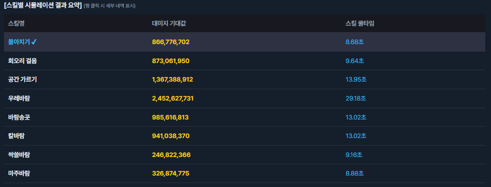
  * 세팅을 바꾸는 즉시 스킬별 데미지 계산 결과를 보여줍니다. 컨트롤 패널의 **실시간 계산 ON/OFF** 로 일시정지할 수 있습니다.
* **스킬 시뮬레이션 · 트라이포드**
  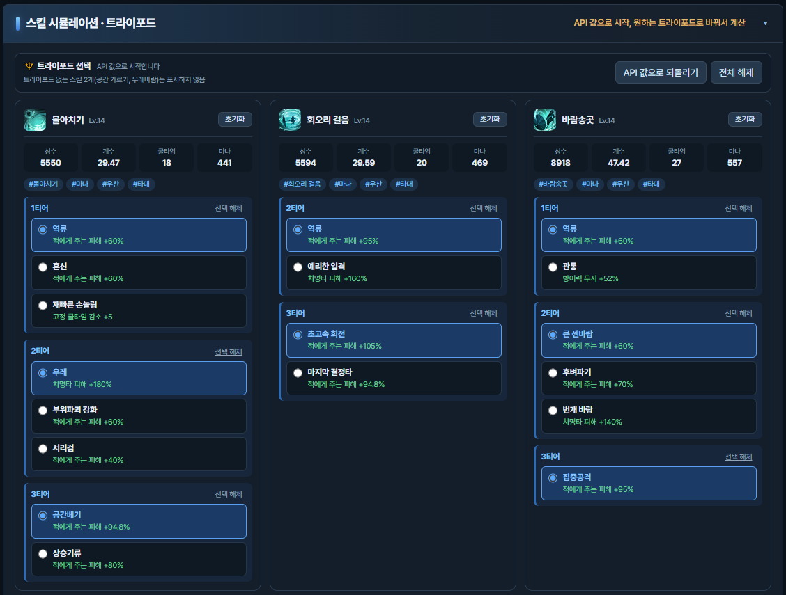
  * API 값으로 시작하고, 원하는 트라이포드로 바꿔서 데미지 변화를 확인합니다. (트라이포드 데이터가 없는 스킬은 목록에서 제외됩니다.)
* **아크 패시브 진화 노드 시뮬레이션**
  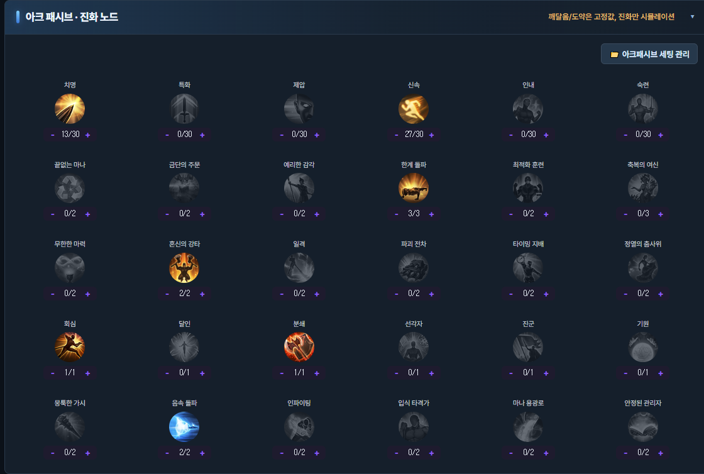
  * 진화 노드를 직접 시뮬레이션하여 데미지 변화를 확인합니다.
* **비교군 저장 및 그래프 비교**
  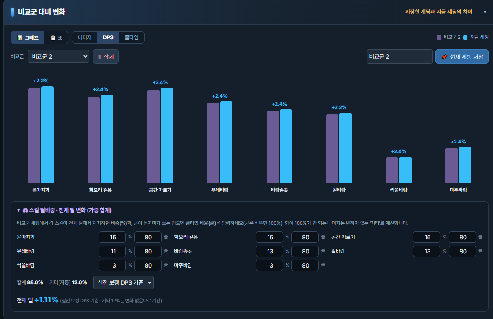
  * 기준 세팅을 저장해 두고 변경 후 데미지·DPS·쿨타임 증감을 그래프와 표로 비교합니다.
  * 스킬 딜비중 가중치와 쿨타임 비율을 설정해 실전 보정 DPS를 계산합니다.
* **진화 노드 최적화**
  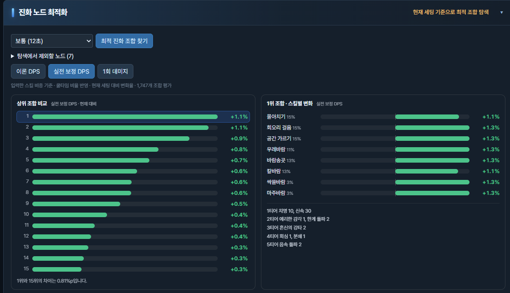
  * 입력된 스킬 딜비중과 쿨타임 비율을 기준으로 진화 노드를 시뮬레이션하고 최적의 진화 노드를 추천합니다.
  * 계산 결과는 이론 DPS(쿨타임 비율 100% 가정)와 실전 보정 DPS(입력된 쿨타임 비율을 기준으로 계산) 및 스킬 1회 데미지를 기준으로 순위를 보여줍니다.
* **아크 그리드 편집**
  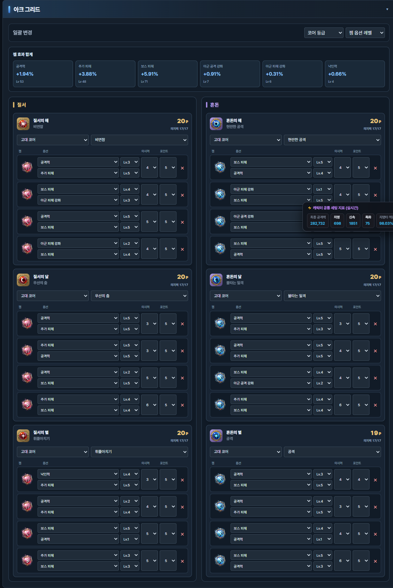
  * 질서·혼돈 코어의 등급과 종류, 코어별 젬(옵션·의지력·포인트)을 직접 바꿔 볼 수 있습니다.
* **보석 · 장비 · 장신구 편집**
  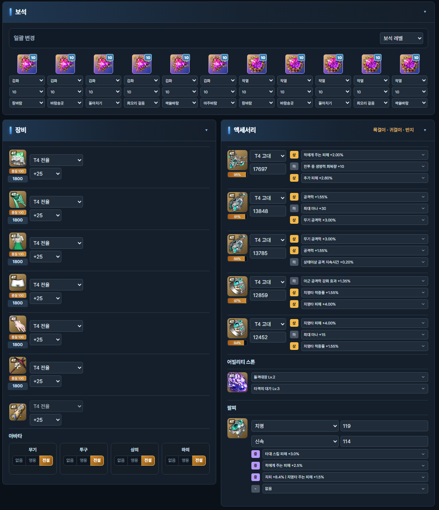
  * 보석 레벨 일괄 변경, 장비 강화/상급 재련 변경, 장신구 옵션과 스탯(범위 제한) 변경, 아바타 등급 선택을 지원합니다.
* **파티 치명타 적중률 시너지 / 에스더 결속 / 다중 치명타**
  * 컨트롤 패널에서 선택해 기댓값에 반영합니다.
* **저장 캐릭터 · API 점검 대응**
  * API 불러오기에 성공한 캐릭터는 브라우저에 자동 저장됩니다. **API 서버 점검이나 장애 시 저장된 같은 이름의 캐릭터를 자동으로 불러옵니다.** (최대 15개)
* **설정 백업 / 복원**
  * **DB 프리셋 관리 → 설정 백업 / 복원** 에서 데이터, 저장 캐릭터, 비교군, 프리셋을 파일 하나로 내보내고 가져옵니다. (API 키는 포함되지 않습니다.)

---

## 데이터 작성 가이드 (Data Creation Guide)

효율적인 데이터 생성을 위해 **[질서 코어 → 직업 특화 → 기본 스탯 → 스킬]** 순서로 진행하는 것을 권장합니다.
앞선 3개 단계에서 설정한 **적용 조건/대상 태그**들을 미리 정리해 두면, 마지막 스킬 작성 시 태그 누락 없이 정확하게 매칭시킬 수 있습니다.

**`데이터생성.html`** 파일을 사용해 데이터를 만드실 수 있습니다.

---

### 1. 질서 코어 (아크그리드) 데이터 작성

* 탭 메뉴: `질서 코어 생성기`

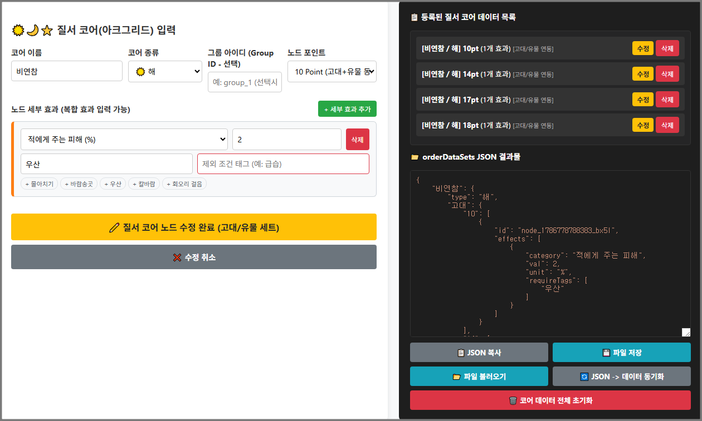

개별 질서 코어의 데이터를 입력합니다. 한 파일에 하나의 코어 정보만 입력하면 됩니다. 여러 개의 질서 코어를 입력하면 코어 조합을 바꿔가며 시뮬레이션 할 수 있습니다.

1. **코어 이름/종류 선택**: 코어 이름과 종류를 선택합니다.

2. **그룹 아이디 (Group ID)**: 코어 내에서 '합연산'이 필요한 데이터가 있을 때 사용합니다. (선택 사항, 빈칸 가능)
   `[14P] '운명' 발동 시 '운명: 바람의 칼날' 효과를 획득한다. '운명: 바람의 칼날': 다음 사용하는 칼바람의 피해량이 25.00% 증가한다. 칼바람 사용 시 버프는 제거된다.`
   `[17P] '운명' 발동 시 다음 사용하는 칼바람 시전 시 피격이상에 면역이 되고, '운명: 바람의 칼날' 효과의 피해 증가량을 44.0%로 변경한다.`
   예를 들어 '바람의 칼날' 코어는 14P와 17P가 합연산으로 계산됩니다.
   이러한 경우 그룹 아이디에 같은 아이디를 입력해야 합연산으로 계산됩니다.
   그룹 아이디 없이 입력하면 곱연산이 되어 바람의 칼날은 44%의 데미지 증가가 아니라 25%와 44%가 곱연산으로 적용되어 계산에 오류가 생깁니다.
   입력할 때 17P 증가량을 따로 계산해서 입력하실 필요 없습니다. 바람의 칼날의 경우 14P에 25%, 17P에 44%를 입력하시면 됩니다.
   그룹 아이디 이름은 아무거나 해도 상관 없습니다. 합연산이 되는 것들의 이름이 같기만 하면 됩니다.

3. **노드 포인트 선택**:
   * `10pt`, `14pt`, `18~20pt`: 고대/유물 공통 수치 자동 생성
   * `17pt`: 고대 수치와 유물 수치를 각각 분리하여 입력

4. **세부 효과 및 조건 태그 입력**:
   * 스탯/피해 범주 선택 후 수치 입력
   * 한 번에 여러 개의 카테고리 효과가 들어간다면 **세부 효과 추가**로 모두 넣어 주셔야 합니다.
     예시 - `[14P] 칼바람의 재사용 대기시간이 5.0초 증가하지만, 피해량이 30.0% 증가한다.` → `쿨타임 증가`와 `적에게 주는 피해` 2가지를 나눠서 입력
   * **적용 조건 태그**: 특정 스킬이나 스킬 그룹에만 적용되는 효과라면 해당 스킬의 태그를 입력합니다. (예: `칼바람`, `타대`, `우산`)
     예시 - `[17P] 회오리 걸음, 몰아치기의 피해량이 12.0% 증가한다.` → `회오리 걸음`, `몰아치기`를 필요 태그에 입력합니다.
   * **제외 조건 태그**: 특정 스킬이나 스킬 그룹을 제외해야 하는 경우 제외 태그를 입력합니다.
     예시 - `금술 스킬을 제외한 곰 스킬의 피해량이 12.5% 증가한다.` → `금술` 태그를 제외 태그에 입력합니다.

---

### 2. 직업 특화 설정

* 탭 메뉴: `직업 특화 설정`

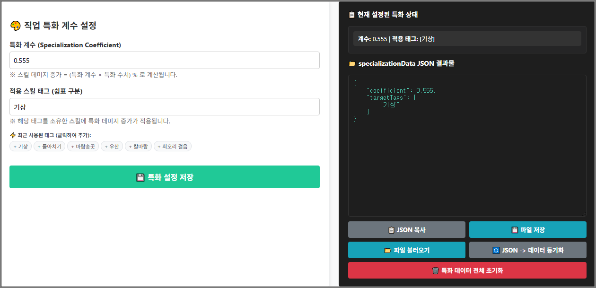

직업의 특화 스탯이 특정 스킬 계수에 주는 영향을 설정합니다.

1. **특화 계수 (Specialization Coefficient)**: 특화 계수를 입력합니다.
   특화 계수는 특화 수치 699일 때 캐릭터 정보창에 표기되는 값으로 `인게임 정보창 특화 효과 × 6.99 / 특화 수치`로 계산할 수 있습니다.
   예를 들어 특화가 1854일 때 인게임 정보창에서 특화 데미지 증가 수치가 88.05%라면 특화 계수는 88.05 × 6.99 / 1854 = 0.3319 입니다.

   직업별 특화 계수는 게임 데이터에서 확인한 값을 `특화계수.json`에 정리해 두었습니다.

2. **적용 스킬 태그**: 특화 데미지 증가 효과를 받는 스킬 태그들을 쉼표(`,`)로 구분하여 입력합니다. (예: `우산`, `급습`, `랜스`)
3. **[특화 설정 저장]** 버튼을 눌러 반영합니다.

---

### 3. 기본 스탯 작성

* 탭 메뉴: `기본 스탯 생성기`

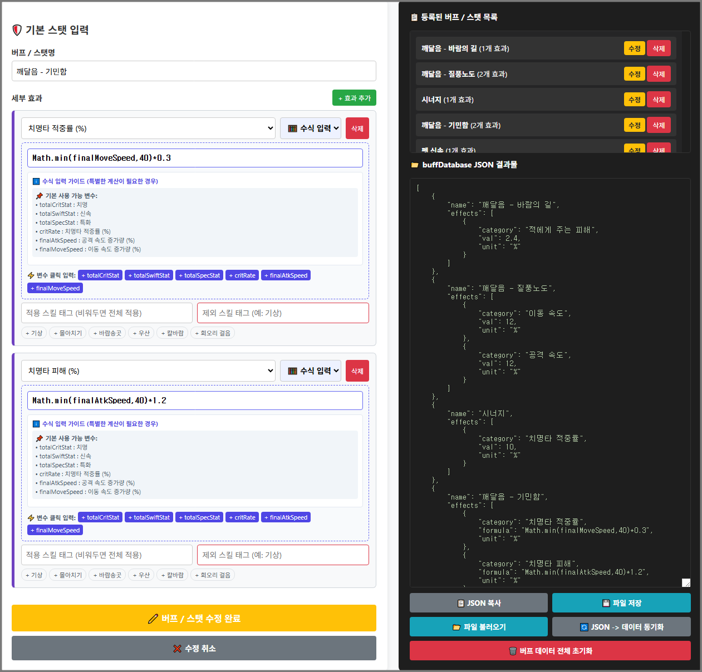

**캐릭터 시너지**, **펫 효과**, **아크 패시브 깨달음**, **아크 패시브 도약**과 추가적으로 캐릭터에 적용되는 고유 버프 정보(예: 버서커 폭주)를 입력합니다.

1. **버프 / 스탯명**: 버프의 이름을 입력합니다. (예: `깨달음 - 질풍노도`, `사이드 노드 - 바람의 길`). 원하는 스타일로 입력하시면 됩니다.

2. **세부 효과 추가**:
   * 효과 범주(치명타 적중률, 공격력 %, 쿨타임 감소 등)와 수치를 입력합니다.
   * 특별한 계산식이 필요한 경우 수식을 입력할 수 있습니다.
     예를 들어 워로드 깨달음 '건랜스 수련'은 **치명타 발생 확률 1%당 랜스 스킬의 피해량 0.6% 증가**인데,
     `Math.min(critRate, 100) * 0.6` 으로 입력하면 실시간으로 치명타 적중률을 계산해 수치를 계산합니다.

     > **현재 지원하는 변수 목록**
     > * `totalCritStat` : 치명. 캐릭터 치명 수치
     > * `totalSwiftStat` : 신속. 캐릭터 신속 수치
     > * `totalSpecStat` : 특화. 캐릭터 특화 수치
     > * `critRate` : 치명타 적중률 (%). 100%를 초과할 수 있습니다. 100%를 상한으로 계산하는 경우 `Math.min(critRate, 100)` 과 같은 계산식으로 사용합니다.
     > * `finalAtkSpeed` : 공격 속도 증가량 (%). 공격 속도가 135%라면 증가량은 35%입니다. 40%를 초과할 수 있습니다. 마찬가지로 40%를 상한으로 계산하는 경우 `Math.min(finalAtkSpeed, 40)`으로 계산합니다.
     > * `finalMoveSpeed` : 이동 속도 증가량 (%). 이동 속도가 135%라면 증가량은 35%입니다. `finalAtkSpeed`와 같습니다.

   * **적용 스킬 태그**: 해당 버프가 특정 스킬군에만 들어가는 경우 태그를 작성합니다. (비워둘 경우 캐릭터 전체 적용)

3. **[+ 버프 / 스탯 목록에 추가]** 버튼을 클릭합니다.

---

### 4. 스킬 데이터 작성

* 탭 메뉴: `스킬 데이터 생성기`

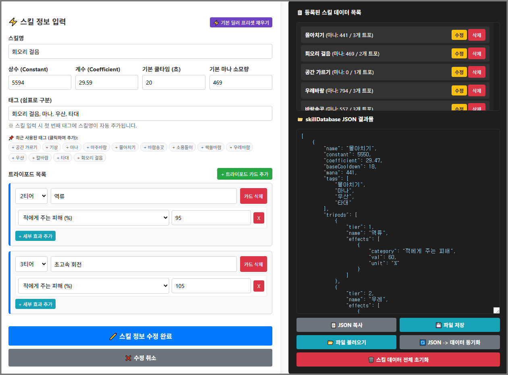

앞서 작성한 **질서 코어, 특화, 버프에서 사용했던 태그들을 포함**하여 최종 스킬 데이터를 구성합니다.

1. **기본 정보 입력**: `스킬명`, `모션 상수(Constant)`, `모션 계수(Coefficient)`, `기본 쿨타임(초)`, `마나 소모량`을 입력합니다.
   `마나 소모량`은 마나 관련 아크 패시브 노드나 각인을 사용하지 않는 경우 입력하지 않아도 됩니다.

   * 로스트아크 스킬 데미지는 **모션 상수 + (공격력 × 모션 계수)** 로 계산됩니다.
     자세한 내용은 [인벤 게시글](https://www.inven.co.kr/board/lostark/4821/109679)을 참고해 주세요.
   * 모션 상수는 **공격력이 0일 때의 스킬 툴팁 표기 데미지**입니다.
     장비, 장신구, 코어, 젬을 전부 빼서 캐릭터 정보창의 공격력이 0인 것을 확인한 뒤 스킬창의 툴팁을 보고 입력하면 됩니다. 모션 상수는 인벤 스킬 정보에서도 확인할 수 있습니다.
   * 모션 계수는 **(공격력이 n일 때의 스킬 툴팁 표기 데미지 − 모션 상수) ÷ 공격력 n** 으로 구할 수 있습니다.
   * 사용하는 스킬 레벨에 맞춰서 모션 상수와 모션 계수를 찾아 입력하세요.

2. **태그 입력 (중요)**:

   * 계산 시 데이터의 적용 여부를 **태그**로 판단합니다. 예를 들어 계산식이 **`백어택` 스킬 데미지 증가**인 경우 `백어택` 태그가 있는 스킬에만 적용됩니다.
   * **첫 번째 태그는 반드시 스킬 이름**으로 작성합니다. 자동으로 추가됩니다.
   * 앞에서 작성한 데이터의 필요/제외 태그들이 자동으로 추천 태그 목록에 등록됩니다.
   * 1~3단계에서 정리해 둔 **조건 태그(예: `스킬명`, `백어택`, `마나`, `우산`, `기상` 등)가 빠짐없이 포함되었는지 확인**합니다.
   * 기본적으로 필요한 태그는 `마나` `백어택` `헤드어택` `타대` 4가지입니다. 아크 패시브 계산에 필요하므로 반드시 넣어 주셔야 합니다.

3. **트라이포드 추가**:
   * 각 티어(1/2/3티어)별 트라이포드 이름과 세부 효과를 등록합니다. 트라이포드 시뮬레이션이 가능하므로 시뮬레이션을 원하는 트라이포드를 모두 입력해 줍니다.
   * 하나의 트라이포드에 2가지 이상의 효과가 있는 경우 세부 효과 추가로 2개 이상의 효과를 하나의 트라이포드에 적용할 수 있습니다.
   * 트라이포드를 하나도 입력하지 않은 스킬은 시뮬레이터의 트라이포드 시뮬레이션 목록에 표시되지 않습니다.

4. **[+ 스킬 목록에 추가]** 버튼을 클릭하여 저장합니다.

---

### 5. 데이터 저장 및 내보내기 (Export / Import)

* 모든 데이터 작성이 완료되면 각 탭 우측 하단의 **`파일 저장`** 버튼으로 JSON 파일을 추출할 수 있습니다.
* 기존 작업 파일을 불러올 때는 **반드시 해당 데이터의 탭으로 이동**한 후 **`파일 불러오기`**를 진행해야 합니다.
* 완성한 JSON 파일은 시뮬레이터의 **데이터 불러오기**에서 한꺼번에 올리면 됩니다.

---

## 사용 시 유의사항 (Important Notes)

1. **지원 범위**
   * 장비는 **T4 전율 및 에스더 장비**만 지원합니다.
   * 보석은 **6레벨 이상**만 계산합니다.
   * 몇몇 각인, 아크 패시브 노드는 계산을 지원하지 않습니다. 데미지 계산과 관계없는 데이터, 주로 서포터 데이터는 지원하지 않으며, 혼돈 코어 중 서포터 옵션은 지원하지 않습니다.
2. **기본 세팅은 고정 입력값을 사용합니다.**
   * 능력치 증가 물약, 원정대 레벨, 전투 레벨, 카드 도감, 만찬, 펫 목장 등 공통 요소는 최대치 기준으로 계산합니다. 아바타 등급은 장비 섹션에서 직접 선택합니다.
3. **API 값을 기준으로 합니다.**
   * 장신구 스탯이 정해진 범위를 벗어나는 경우처럼 API 값이 예상과 다를 수 있으며, 직접 수정할 때만 범위가 적용됩니다.
4. **믿을 수 있는 JSON만 불러오세요.**
   * 데이터의 계산식은 브라우저에서 코드로 실행됩니다. 출처를 알 수 없는 JSON이나 백업 파일은 열기 전에 내용을 확인해 주세요.
5. **API 키는 본인만 사용하세요.**
   * 키는 브라우저에만 저장되며 백업 파일에도 포함되지 않습니다. 공용 PC에서는 사용 후 **API 키 지우기**를 눌러 주세요.
6. **브라우저 데이터를 지우면 저장한 데이터가 사라집니다.**
   * 중요한 데이터는 **설정 백업**으로 파일에 보관해 두세요.

---

## 업데이트 안내

* 웹 페이지이므로 **새로고침하면 항상 최신 버전**이 적용됩니다. 별도의 설치나 업데이트가 필요 없습니다.
* 업데이트 후에도 저장해 둔 데이터와 캐릭터는 같은 브라우저에서 그대로 유지됩니다.

<!-- 기존 Tampermonkey 스크립트를 계속 제공한다면 이 위치에 안내를 추가하세요. -->

---

## 오류 제보 및 문의

버그 제보나 기능 제안은 GitHub 저장소의 **[Issues]** 탭에 남겨주시면 빠르게 반영하겠습니다!
